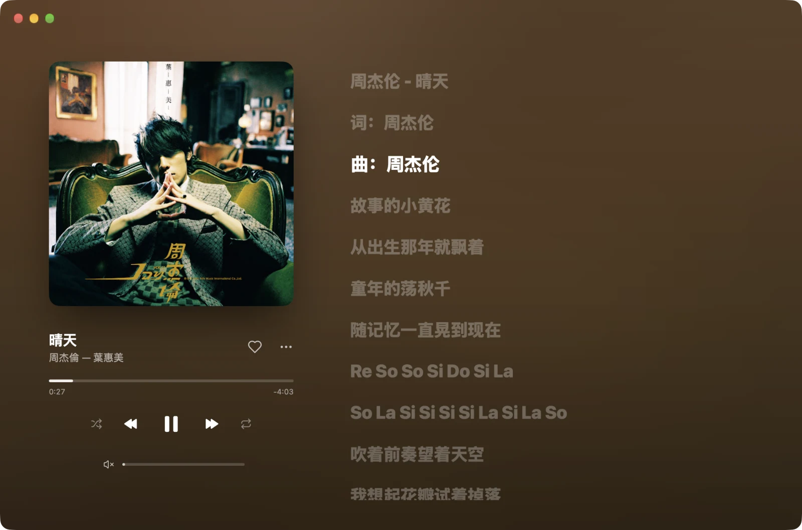
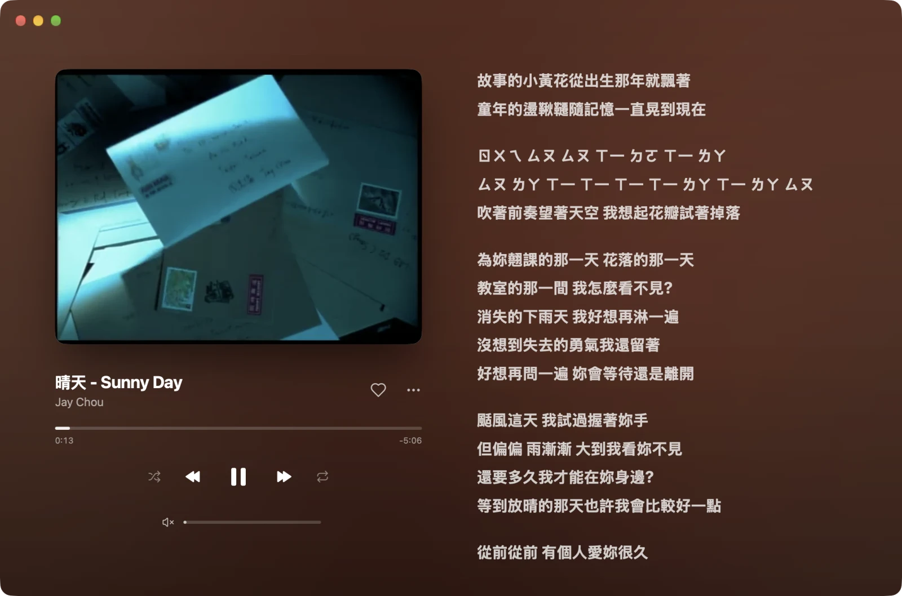
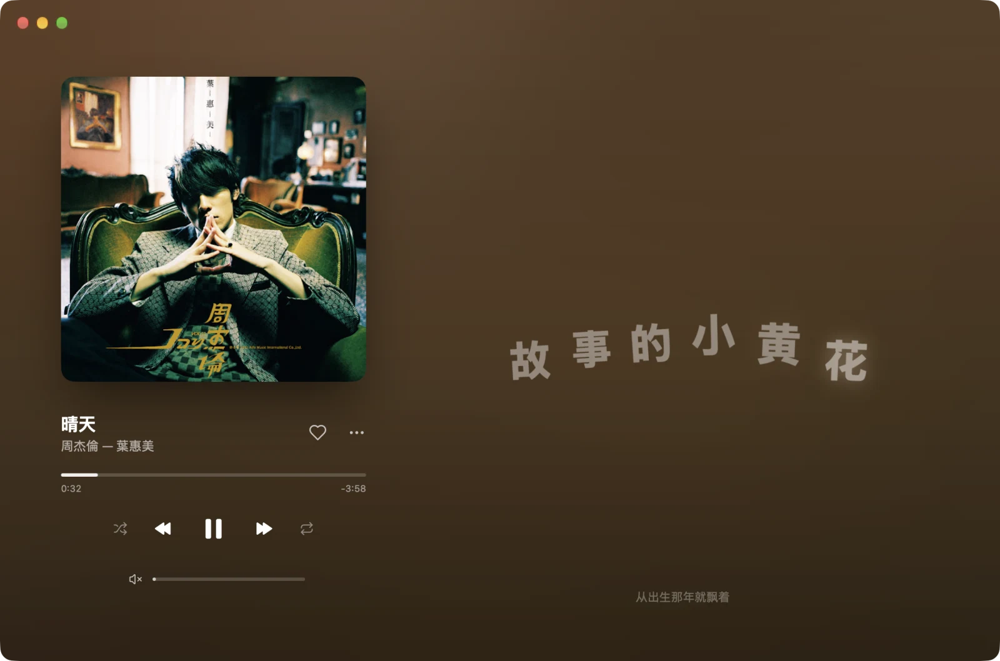
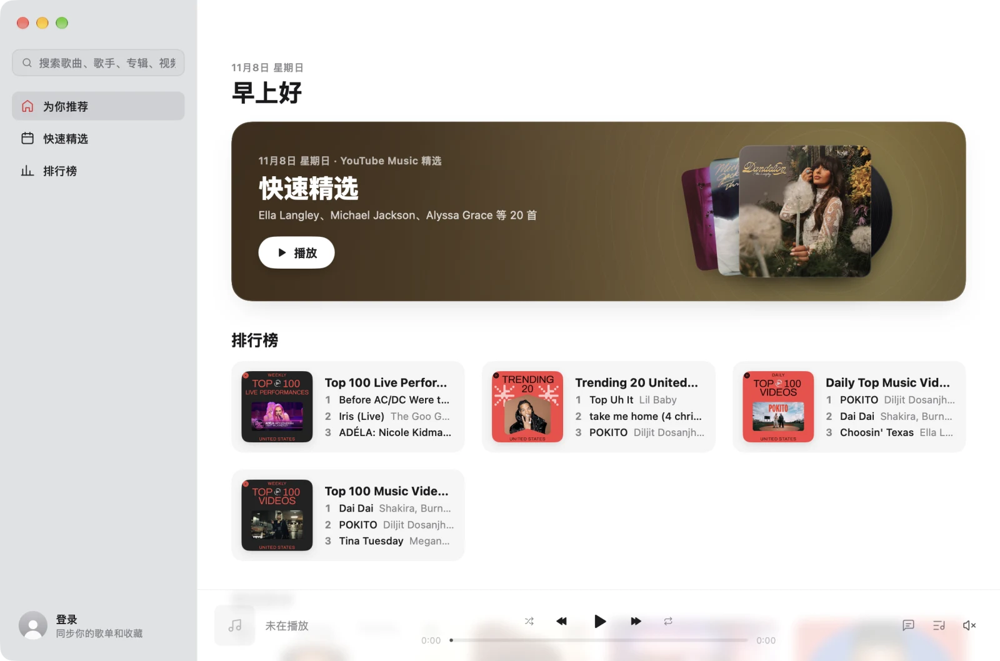
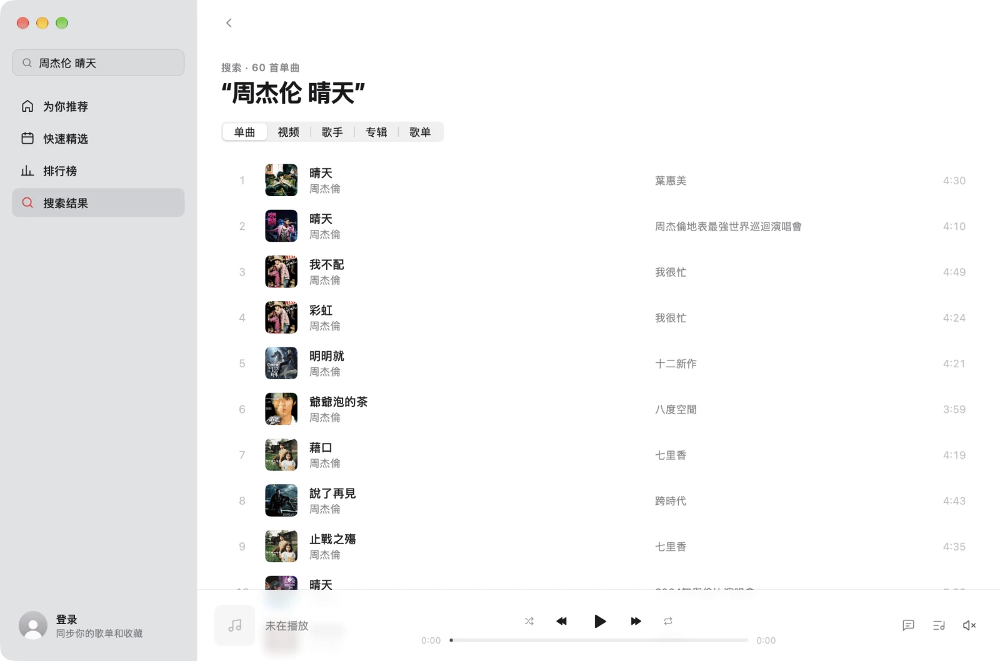

# YTB Music

English | [简体中文](README.zh-CN.md)

A desktop client for YouTube Music, written in Go with [MyGo](https://github.com/egoist/mygo): its interface is drawn natively by MyGo, and neither songs nor music videos start a WebView.

It reworks the interface and player of [mygo-cloudmusic](https://github.com/egoist/mygo-cloudmusic), with its music from YouTube Music. The interface is in Chinese.



| The music video in the cover's place | Lyrics in motion |
| --- | --- |
|  |  |
| **Home** | **Search** |
|  |  |

## Download

From [Releases](https://github.com/wishworldbetter/ytb-music/releases):

- **macOS 13+** (Apple silicon and Intel in one): the `.dmg`, signed with a Developer ID and notarized by Apple
- **Windows** (x64, ARM64): the installer is not code-signed, so SmartScreen may warn; choose "Run anyway"
- **Linux** (x64, ARM64): the `.deb` or the `.tar.gz`

## Features

- Home, Quick picks and Charts
- Search for songs, videos, artists, albums and playlists, with suggestions as you type and your history kept
- Playlist, album and artist pages
- Song radio: endless similar songs from any song
- Video: Now Playing switches between the cover and the music video in its place (AVPlayer, decoded in hardware), in time with the song, with a theater mode; the quality follows the network (up to 1080p) or your choice; macOS only
- Streams as it downloads: AAC at 128 kbps, or 256 kbps for a Premium account (macOS only); songs played are cached
- Sign-in: imported from Chrome, Safari, Edge, Arc, Brave, Firefox and other browsers (macOS only), or with a Google account, or a pasted cookie; signed in, your playlists, likes, history and follows sync
- Synced lyrics (LRCLib), lyrics in motion, and plain lyrics where there are no synced ones
- Volume normalization (by YouTube's measured loudness), with fades as playback pauses and resumes
- Now Playing in Control Center and the media keys, a player in the notch, and the menu bar
- Picks up the queue and position where you left them
- Light, dark, or as the system is

Podcasts are not supported yet. To import a sign-in from Chrome, Safari and others, allow YTB Music in System Settings › Privacy & Security › Full Disk Access.

## Building

Needs Go 1.27+. MyGo comes from the `native-video` branch of the fork [wishworldbetter/mygo](https://github.com/wishworldbetter/mygo) (the `replace` in `go.mod`), which adds a native video view. To work on MyGo at the same time, clone it beside this repository as `../mygo` and make a `go.work` (ignored by git): `go work init . ../mygo`.

```bash
go tool mygo dev     # run in development
go tool mygo build   # package into build/
go tool mygo build -platform windows/amd64,linux/amd64   # cross-compile Windows and Linux apps on a Mac
go test ./...        # run the tests; LIVE=1 also runs those that call YouTube
```

The app makes the screenshots itself: run with `NM_SHOTS=<dir> NM_SCENE=readme`, and it walks through its pages and marks each one (see `internal/app/debug_shots.go`).

## Releasing

1. Bump `version` in `mygo.json` and `CHANGELOG.md`, commit, and push its tag (such as `v0.2.0`)
2. GitHub Actions builds the Windows (installers) and Linux (.deb, tar.gz) apps on Ubuntu into a draft release
3. On a Mac, `scripts/release-mac.sh -upload` builds the universal app (Apple silicon and Intel), signs it with the Developer ID, has Apple notarize it through `asc`, staples the ticket, and adds it to the same draft
4. Review the draft and publish it

## How it works

- Browsing and search use InnerTube (music.youtube.com's `WEB_REMIX` client)
- Audio and video streams come from the `VISIONOS` client: audio is itag 140 (AAC-LC), downloaded a range at a time; video is the fitting H.264 variant of the HLS manifest
- Premium's 256 kbps (itag 141) comes from the signed-in `WEB_REMIX` client, its URL scrambled by YouTube's player script: [yt-dlp/ejs](https://github.com/yt-dlp/ejs) unscrambles it in the system's JavaScriptCore, falling back to 128 kbps when it can't
- MyGo's `audio/aac` decodes the audio; the video is MyGo's native `VideoView` (an AVPlayerLayer), muted and kept in time with the audio, without a WebView
- Importing a sign-in reads each browser's cookie database (Chromium's decrypted with the key in the Keychain)
- The Windows and Linux apps build, but video, importing a sign-in and 256 kbps are macOS only for now

## Thanks

- [MyGo](https://github.com/egoist/mygo): the native UI and app framework
- [mygo-cloudmusic](https://github.com/egoist/mygo-cloudmusic): the interface and the player
- [LRCLib](https://lrclib.net): synced lyrics
- [yt-dlp/ejs](https://github.com/yt-dlp/ejs): unscrambling YouTube's stream URLs (the Unlicense, bundling meriyah and astring)

This project is not affiliated with YouTube or Google. Music rights belong to their owners.

## License

[AGPL-3.0](LICENSE)
